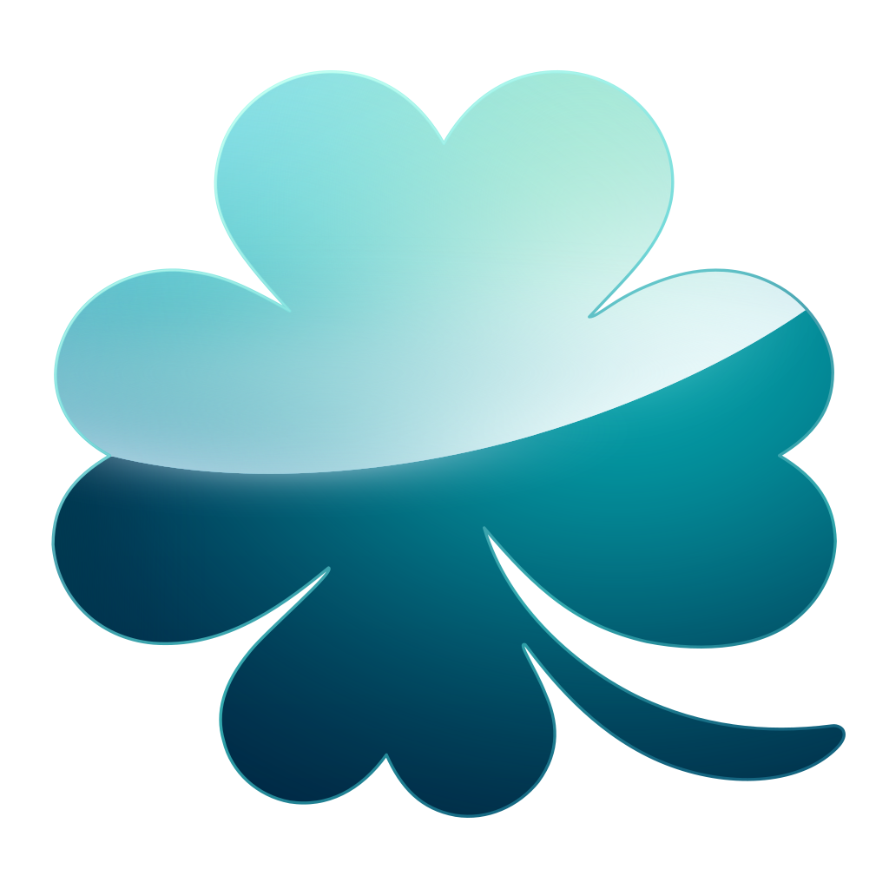

# sena-rs


Rust cross-platform implementation of the SoftPAL engine.
Specifically, targeted for the game "Koikake".

<br clear="left"/>

## Example screenshots

* sena-rs on macOS


* sena-rs on iOS


| Platform | Targets |
|---|---|
| Linux | x86_64, aarch64 |
| Windows | x86_64, ARM64 |
| macOS | DMG app bundle |
| iOS | arm64 device, arm64 simulator, x86_64 simulator |
| Android | arm64-v8a, x86_64 |
| WebAssembly | wasm32-unknown-unknown |
| Nintendo Switch | Homebrew NRO, experimental; package build verified |
| PlayStation Vita | Homebrew VPK, experimental; package build verified |

See [platform build instructions](platform/README.md) for SDK requirements,
controls, artifacts, and validation limits. Console hardware has not been tested.

## Run

```bash
cargo run -p pal-vm --release --bin sena -- /path/to/game --nls sjis
```

## Claims
<p align="center">
  
</p>

This project belongs to `CrySirror` [project](https://github.com/xmoezzz/CrySirror), which is a unified engine backend for visual novels and 3D games. 

1. Bug fixes and improvements for the SoftPAL engine is acceptable in this repository. 

2. If you want to support a new platform (e.g. game console), please create an issue or pull request in the `CrySirror` repository instead of this one. 


## License
This project is licensed under the MPL-2.0 License. See [LICENSE](./LICENSE-MPL-2.0) for details.
